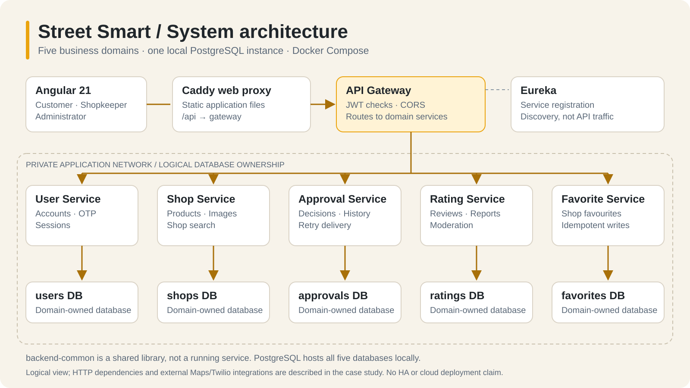
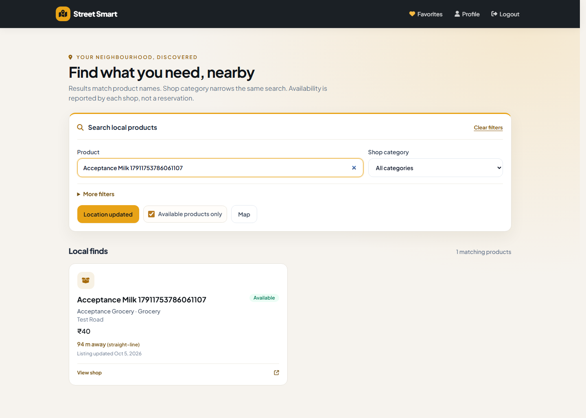
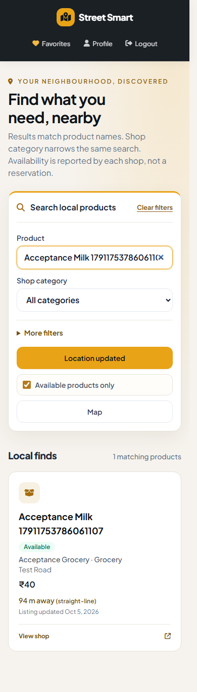
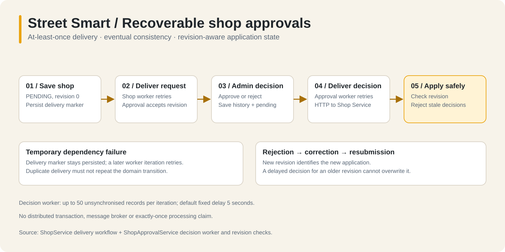
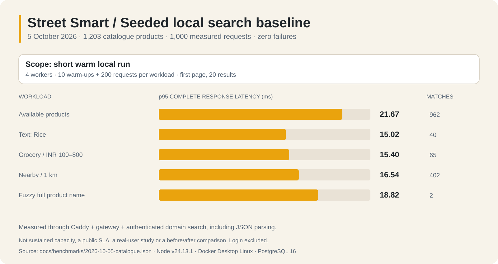

# Street Smart — Finding products, not just shops

> A local-commerce discovery application that connects customer product searches
> to shop inventories, with role-aware catalogue management, approval workflows
> and review moderation.

This case study includes implementation updates from **10 October 2026** and
retains the dated October 5 search benchmark.
Implementation details come from source/configuration; measured results come
from the dated local verification record. It does not claim a public deployment,
real customer adoption or production traffic.

## At a glance

| Attribute | Project detail |
| --- | --- |
| Purpose | Discover products stocked by local shops |
| Users | Customers, shopkeepers and administrators |
| Frontend | Angular 21, TypeScript, RxJS and responsive styling |
| Backend | Java 17, Spring Boot 3.5.16 and Spring Cloud 2025.0.3 |
| Data | PostgreSQL 16; five domain-owned databases in one local database container |
| Runtime | Docker Compose, Caddy web proxy, Spring Cloud Gateway and Eureka |
| External integrations | Optional Google Maps and Twilio Verify |
| Delivery status | Locally exercised application; AWS learning-lab configuration exists but no deployment is claimed |

## 1. The problem and product boundary

A shop-name search answers “Which shop do I already know?” rather than “Who
stocks the item I need?” Street Smart makes a **product/shop pair** the discovery
result. Customers can compare a product's listed price and availability, see
the associated shop and optionally narrow results to a geographic radius.

The application also addresses the maintenance behind discovery: shopkeepers
need to add and update stock information; administrators need to approve shops;
customers need favourites, reviews and a way to report inappropriate reviews.

This is a discovery application, not an order-management system. There is no
checkout, payment processing, stock reservation or delivery fulfilment claim.
Availability is maintained by the shopkeeper and is not a purchase guarantee.
The category filter describes the **shop category**, not a product taxonomy.

## 2. Three connected journeys

| Role | Main journey | Important boundary |
| --- | --- | --- |
| Customer | Register/sign in → search products → filter results → inspect a shop → save a favourite or write/report a review | Protected actions derive identity from the authenticated subject |
| Shopkeeper | Register/sign in → submit shop → respond to rejection → manage products and shop images | A shopkeeper can edit their own resources, not another shop's catalogue |
| Administrator | Sign in → decide shop applications → inspect report pages → dismiss a report or remove a review | There is no public administrator self-registration endpoint |

### Customer dashboard design

The dashboard uses the project's ivory, charcoal and amber visual language.
Product search, category and availability remain visible. Price, radius and
typo matching are grouped in one expandable “More filters” section rather than
repeated or hidden duplicate controls. Reset clears the search and filter state.
Results show product name, shop/category, price, availability, freshness and,
when location is available, a labelled straight-line distance.

The following are **actual local browser captures using synthetic acceptance
data**, not mockups. Their long fixture names reflect automated tests, not real
customer inventory. The mobile capture is a full-page image taken at a
390 × 844 viewport; the desktop viewport was 1440 × 1000.

## 3. Architecture and ownership

There are **five business services**, two infrastructure services and one shared
library. The Maven reactor contains eight child modules plus its root aggregator;
the shared library is not an independently running service.

| Component | Responsibility | Owned data |
| --- | --- | --- |
| UserService | Accounts, authentication, phone verification and session lifecycle | `users` database |
| ShopService | Shop profiles, products, search and shop images | `shops` database |
| ShopApprovalService | Applications, decisions, history and retryable decision delivery | `approvals` database |
| RatingService | Reviews, summaries, review reports and administrator moderation | `ratings` database |
| FavoriteService | Idempotent customer shop favourites | `favorites` database |
| DiscoveryClient | Spring Cloud Gateway routing, JWT checks and explicit-origin CORS | No domain database |
| EurekaServer | Service registration and discovery | No domain database |
| backend-common | Shared authentication/session validation, errors, tracing and client configuration | Library, not a service |

The local Compose topology runs one PostgreSQL instance with five databases.
This provides logical domain ownership, **not five physically isolated database
servers**. Cross-service operations use HTTP boundaries rather than writing
another service's tables. Flyway versions each domain's schema.

The lab web container serves Angular through Caddy and proxies `/api` to the
gateway. The base stack publishes the gateway on loopback; adding the lab
overlay also publishes the web endpoint. Business-service ports, PostgreSQL
and Eureka are not exposed by the normal application topology. The isolated
acceptance stack uses different ports and a separate project/volume.

## 4. Search that matches the product question

ShopService executes product search against its products and associated shops.
Filtering happens **before server pagination**. The query includes eligible
shop states (`APPROVED`, `ACTIVE`, `INACTIVE`), excludes pending/rejected shops
and returns product/shop details rather than making the browser join records.
An eligible shop state does not itself guarantee that the shop is open now.

| Capability | Implemented behavior | Limitation |
| --- | --- | --- |
| Text | Case-insensitive product-name substring matching with escaped wildcard characters | No synonym or semantic-search engine |
| Category | Matches shop category | Not a separate product-level taxonomy |
| Availability | Optional available-only predicate | Owner-reported; no reservation |
| Price | Minimum/maximum bounds; INR is the frontend's currency | Prices may be absent; no checkout |
| Nearby | Latitude prefilter followed by spherical distance; valid coordinates and a radius up to 100 km required | Straight-line estimate, not walking/driving distance or PostGIS |
| Typo matching | Opt-in Levenshtein comparison with maximum edit distance 2; at least 3 query characters | Compares whole names, not independent word tokens |
| Pagination | Page 0–10,000, size 1–100; stable result ordering | Offset pagination; deep-page performance not established |

Ordinary results order by lowercased product name, shop name and product ID.
Radius searches prepend distance to that ordering. PostgreSQL search extensions
and indexes support the substring/fuzzy path; this is still database-backed
search, not Elasticsearch. Product discovery remains usable without Maps or
location permission. Maps enriches location presentation rather than owning
the catalogue search contract.

Source: [ProductSearch.java](../ShopService/src/main/java/com/shopapp/ShopService/service/ProductSearch.java).

## 5. Reliability: decisions that survive temporary failures

Shop registration and administrator approval cross two database owners. A
single local transaction cannot atomically update both databases. The design
persists local state and its delivery marker, then retries cross-service HTTP
delivery using workers. Approval Service's decision worker processes up to 50
unsynchronised records per iteration, with a default fixed delay of 5 seconds.

Registration starts at revision 0. Rejected applications can be corrected and
resubmitted with an incremented revision. Duplicate delivery is handled
idempotently, and an old decision cannot overwrite a later resubmission.
History retains previous decisions and the administrator's audit information.

This is **at-least-once delivery with eventual consistency**. It is not an
exactly-once message broker, a distributed transaction or Kafka-based outbox.
Persisted delivery markers make retries recoverable; the UI can distinguish a
saved decision from a downstream update still awaiting delivery.

Sources: [approval service](../ShopApprovalService/src/main/java/com/shopapp/ShopApprovalService/service/impl/ShopApprovalServiceImpl.java),
[decision worker](../ShopApprovalService/src/main/java/com/shopapp/ShopApprovalService/service/DecisionWorker.java),
[Shop Service implementation](../ShopService/src/main/java/com/shopapp/ShopService/service/impl/ShopServiceImpl.java).

## 6. Security and session lifecycle

JWT signatures, issuer, expiry and audience are validated at the gateway and
domain-service boundaries. Protected ownership decisions come from the signed
subject, not a user ID supplied by the browser. Role checks enforce customer,
shopkeeper and administrator capabilities. Internal routes use a separate
service credential.

The configured domain services also validate sessions against UserService.
That validation fails closed when the session store is unavailable: a valid
JWT signature alone does not make a revoked session acceptable. This creates
an intentional availability dependency on UserService for protected actions.
The shared validator can skip session lookup if its URL is left blank, so the
claim applies to the configured Compose topology, not every possible setup.

Users can list sessions, revoke one owned session or sign out all devices.
Sensitive profile changes invalidate sessions. Refresh secrets now rotate via
an HttpOnly cookie; only hashes are stored. Reuse revokes the session, whose
absolute lifetime is seven days. Angular coordinates concurrent renewal within
one tab and renews expired access before protected navigation.

Twilio Verify is optional. Enabled registration uses send/verify endpoints and
single-use verification proof. Disabled local SMS mode visibly creates
unverified accounts. The isolated test profile replaces real delivery with a
fixed local OTP; it must not be confused with real SMS verification. Google
Maps uses a browser key; database, JWT and SMS credentials must not enter the
frontend's public runtime configuration.

Source: [session validator](../backend-common/src/main/java/com/shopapp/common/SessionValidation.java),
[security and operations](SECURITY_OPERATIONS.md).

## 7. Moderation that preserves evidence

Customers cannot report their own reviews or submit duplicate reports for the
same review. A report stores a review snapshot before an administrator acts.
Removing the review retains the report, reason, resolution time and resolver
identity rather than cascading away the evidence.

The administrator queue returns a paged response by status, with a default
size of 20, a maximum size of 100 and deterministic creation-time/ID ordering.
The frontend reloads after a decision and returns to an existing page when
removing the last report empties the current page. A backend regression creates
105 reports to verify the sixth page, total count and invalid pagination bounds.

Source: [RatingServiceImpl.java](../RatingService/src/main/java/com/shopapp/RatingService/service/impl/RatingServiceImpl.java).

## 8. Measured local results

### Verification record

| Evidence date | Check | Result and scope |
| --- | --- | --- |
| October 5, 2026 | Angular production build | Passed |
| October 5, 2026 | Frontend unit tests | 62 ChromeHeadless tests passed |
| October 5, 2026 | Focused backend tests | Rating Service 7 + backend-common 3 passed; no failures/errors/skips |
| October 5, 2026 | Isolated API smoke | OTP/account, approval/rejection/resubmission, catalogue, reviews, favourites, moderation retention and logout checks passed |
| October 5, 2026 | Browser acceptance | Five distinct checks passed across main/focused reruns, including separate live Maps validation; not one final combined suite |
| October 5, 2026 | Visual review | Populated desktop/mobile dashboard captures inspected; no horizontal overflow observed |
| October 5, 2026 | Real SMS | Not exercised in this pass; isolated OTP used a test provider |
| September 21, 2026 | Historical full Maven reactor | 65 tests passed; not rerun in full on October 5 |

Counts from different runs must not be added together. The October 5 browser
acceptance was not a formal accessibility audit. A repeatable automated audit was
added on October 10; see [its scope and results](LOCAL_FEATURE_VERIFICATION.md).
Neither builds nor unit tests establish production readiness.

### Search benchmark methodology and data

The API seeder created 12 approved fixture shops with 100 products each across
six shop categories. Of those 1,200 products, 960 were available. Three prior
acceptance listings remained, giving **1,203 total catalogue rows**. A repeated
seed run added zero products, demonstrating fixture reuse rather than another
1,200 inserts.

Each workload used 10 warm-ups and 200 measured requests with four workers,
returning the first 20 results. Requests passed through the web proxy, gateway
and configured downstream session validation. Timing includes receiving and
parsing the complete successful response; failed requests are counted separately
and excluded from latency percentiles. Login is outside the search timings.

| Workload | Matching rows | p50 ms | p95 ms | p99 ms | Successful requests/s | Failures |
| --- | ---: | ---: | ---: | ---: | ---: | ---: |
| Available products | 962 | 15.67 | 21.67 | 25.75 | 243.98 | 0 |
| Product text: Rice | 40 | 12.64 | 15.02 | 21.13 | 307.07 | 0 |
| Grocery category, INR 100–800 | 65 | 11.36 | 15.40 | 23.09 | 334.58 | 0 |
| Within 1 km of fixture location | 402 | 12.52 | 16.54 | 20.38 | 303.75 | 0 |
| Fuzzy full name: Rcie - Variant 1 | 2 | 12.36 | 18.82 | 21.54 | 298.04 | 0 |

All **1,000 measured requests succeeded**. Runtime was Node v24.13.1 against
Docker Desktop Linux containers and PostgreSQL 16. These are short, warm local
regression measurements, not a sustained capacity test, public SLA or evidence
of real users. Deep pagination, cold starts and long-running concurrency were
not measured. The older empty-catalogue run used a different timing method and
is not a valid before/after comparison.

Evidence: [raw benchmark JSON](benchmarks/2026-10-05-catalogue.json),
[full verification and reproduction commands](FINAL_CODE_VERIFICATION.md),
[API fixture seeder](../scripts/seed-performance.mjs),
[measurement harness](../scripts/performance.mjs).

## 9. Engineering tradeoffs and lessons

| Choice | Benefit | Cost or boundary |
| --- | --- | --- |
| Five domain services | Explicit ownership and practice with cross-service failure handling | More processes, networking and local setup than a modular monolith |
| One local PostgreSQL instance | Reproducible Compose setup with independent databases | Shared infrastructure failure/resource contention |
| HTTP workers and persisted markers | Recoverable approval delivery without broker infrastructure | Eventual consistency; retries and revisions remain application responsibilities |
| Authoritative session lookup | Immediate revocation across configured domain services | Extra HTTP work and a UserService availability dependency |
| Images stored in PostgreSQL | Simple local persistence and backup boundary | Less suitable than object storage for large image workloads |
| Optional Maps/SMS integrations | Core local catalogue flow can remain usable without paid integrations | Disabled phone verification and map fallback must be communicated honestly |
| Grouped optional dashboard filters | Keeps the main product-search path focused | Does not replace usability research or an accessibility assessment |

The most useful lesson is that correctness lives in failure paths: delayed
approval decisions, revoked sessions, deleted-review evidence and a disappearing
last moderation page all need explicit handling. Another is to separate claims
from evidence: a fast seeded search is worth reporting, but not extrapolating
into “production scale.”

## 10. Portfolio-ready copy

### Project card

**Street Smart — Product-first local commerce**

Built an Angular and Java/Spring Boot application for finding products at local
shops, with five domain services, PostgreSQL and Docker Compose. Implemented
role-aware catalogue management, revocable sessions, retryable revision-aware
shop approvals and audit-preserving review moderation. Verified customer,
shopkeeper and administrator flows locally and measured five seeded search
workloads over a 1,203-product catalogue.

### Longer portfolio introduction

Street Smart explores the engineering behind a product-first neighbourhood
marketplace: customers search what they need, shopkeepers maintain catalogues,
and administrators manage onboarding and reports. Its five Spring Boot domain
services own separate PostgreSQL databases behind a gateway, with an Angular
frontend and a reproducible Docker environment. The work focuses on ownership
checks, cross-service session revocation, recoverable approval delivery and
moderation evidence retention—not just CRUD screens. Local evidence includes
62 frontend tests, a 10-test focused backend run, desktop/mobile browser checks
and 1,000 successful seeded search requests. It is a local portfolio application,
not a claimed public production deployment.

### Resume bullets

- Built a product-discovery application with Angular 21, Java 17 and five
  Spring Boot domain services, independent PostgreSQL database ownership and
  containerized local operation.
- Implemented revocable JWT sessions, role/ownership checks, audit-preserving
  moderation and at-least-once revision-aware approval delivery.
- Verified role-based workflows locally and benchmarked five search workloads
  across 1,203 catalogue products: 1,000 requests, zero failures, p95 latency
  of 15.02–21.67 ms at four workers in a short warm local run.

## 11. What to demonstrate in five minutes

1. Show the architecture and healthy local services; explain five domains and
   one PostgreSQL instance without overstating isolation.
2. Submit a shop, approve it and explain persisted delivery/revision checks.
3. Add a product and shop image as the shopkeeper.
4. Search that product as a customer; demonstrate filters, optional location,
   favourite and review actions.
5. Report the review, remove it as administrator and show the retained report.
6. Demonstrate session revocation, then show the dated evidence and benchmark
   methodology rather than presenting throughput without context.

Use synthetic accounts only. Do not record `.env`, passwords, tokens, real
phone numbers or provider credentials. No live URL is included because no
public deployment was verified.

## 12. Remaining boundaries

The October 10 pass added rotating refresh tokens, optional on-demand Google
Routes driving estimates, automated axe audits and keyboard dialog acceptance.
See [feature verification](LOCAL_FEATURE_VERIFICATION.md) for scope and setup.
Useful local extensions include token-aware typo matching, product-level
categories/synonyms, human screen-reader evaluation and longer representative
load tests. Automatic holiday/open-now schedules and checkout remain outside
the implemented feature set.

Cloud deployment, managed secrets, administrator MFA and object storage are
possible future work, not prerequisites for describing this completed local
portfolio scope. Credential revocation is an external account action and is
not proven by removing a value from source.

## Asset and evidence index

- [Logical architecture SVG](assets/portfolio/system-architecture.svg) and [PNG](assets/portfolio/system-architecture.png)
- [Approval reliability SVG](assets/portfolio/approval-reliability.svg) and [PNG](assets/portfolio/approval-reliability.png)
- [Benchmark SVG](assets/portfolio/search-benchmark.svg) and [PNG](assets/portfolio/search-benchmark.png)
- [Actual desktop screenshot](assets/portfolio/dashboard-desktop.png)
- [Actual mobile screenshot](assets/portfolio/dashboard-mobile.png)
- [Asset provenance and regeneration](assets/portfolio/README.md)
- [Application setup](../README.md)
- [Dated local verification](FINAL_CODE_VERIFICATION.md)

All diagrams are original, source-derived explanatory assets. They are not
screenshots of a cloud console or evidence that infrastructure was deployed.
